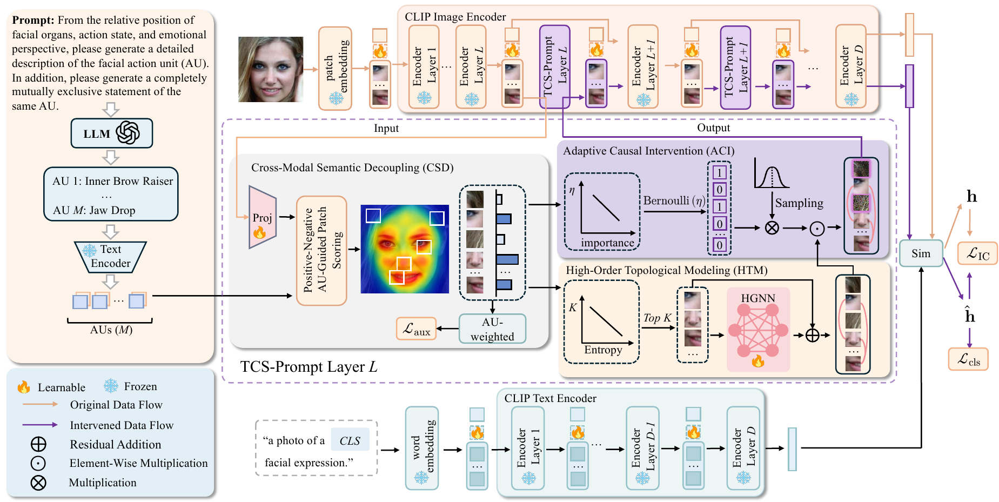

# TCS-Prompt

**Topology-Causal Semantic Prompt Learning for Single Domain Generalization Facial Expression Recognition**

TCS-Prompt studies facial expression recognition when a model is developed on one source domain and evaluated on unseen domains. It combines text and visual prompt learning with action unit (AU) semantics, facial topology, and causal intervention.



## Method

TCS-Prompt builds on CLIP ViT-B/16 and has three main components:

| Component | Role |
| --- | --- |
| Cross-Modal Semantic Decoupling (CSD) | Aligns positive and negative AU descriptions with image patches to estimate the relevance of facial regions. |
| High-Order Topological Modeling (HTM) | Selects informative patches and models their relationships with a hypergraph. |
| Adaptive Causal Intervention (ACI) | Perturbs patches with lower AU relevance during training to reduce reliance on domain-specific cues. |

The notebook contains the model definition, dataset utilities, and an inference-only evaluation workflow. ACI's perturbation is disabled during inference.

## Files

```text
TCS_Prompt.ipynb             Model and evaluation notebook
requirements.txt            Python dependencies
assets/tcs_prompt_overview.png   Method diagram
```

## Environment

Use Python 3.9 or 3.10. The experiments described in the manuscript used a single NVIDIA RTX 3090 GPU.

```bash
python -m pip install -r requirements.txt
jupyter lab TCS_Prompt.ipynb
```

The requirements install the official [OpenAI CLIP](https://github.com/openai/CLIP) package, which supplies the `clip.clip` and `clip.simple_tokenizer` imports used by the notebook.

## Evaluation data

The notebook supports RAF-DB, SFEW 2.0 (named `SFEW` in paths), AffectNet, and FERPlus. Provide datasets in this layout and point `FER_DATA_ROOT` to its parent directory:

```text
fer_dataset/
└── <dataset>/
    ├── labels/
    │   └── <split>.txt
    └── images/
        └── <split>/
            └── <image files>
```

Each line in a label file is `<relative_image_path> <label>`. The notebook maps dataset labels to this seven-class order: surprise, fear, disgust, happy, sad, anger, neutral. Its default evaluation split is `test` for RAF-DB, SFEW, and AffectNet, and `val` for FERPlus. Obtain each dataset through its own provider and follow its usage terms.

Set the dataset path before launching Jupyter:

```bash
export FER_DATA_ROOT=/path/to/fer_dataset
```

The notebook is organized into setup, dataset utilities, model implementation, and evaluation functions. Use the evaluation functions with your local setup.
